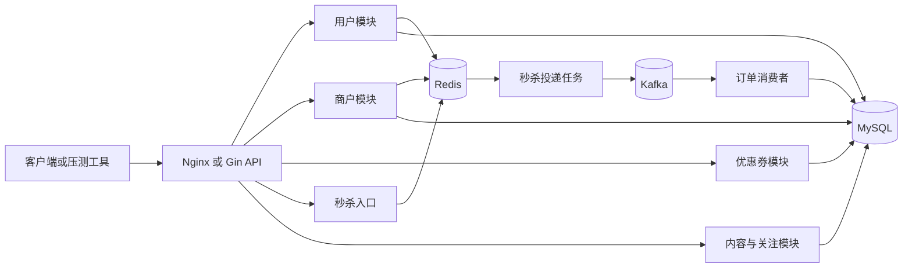

# Go 重构架构

## 1. 总体形态

第一阶段采用模块化单体。一个 API 进程包含多个业务模块，但模块之间通过接口和领域事件边界协作。秒杀的 Kafka Consumer 可以先和 API 共进程运行，后续再拆为独立 `seckill-worker`。



## 2. 推荐目录

```text
hmdp-go/
├── cmd/
│   ├── api/                 # HTTP API 进程入口
│   └── seckill-worker/      # 后续从模块化单体拆出的消费者入口
├── internal/
│   ├── app/                 # 组装依赖、启动和关闭所有组件
│   ├── config/              # 环境变量配置与校验
│   ├── platform/
│   │   ├── mysql/           # GORM 初始化和连接池
│   │   ├── redis/            # go-redis 初始化和脚本
│   │   ├── kafka/            # Producer、Consumer 和 Topic 管理
│   │   ├── httpx/            # HTTP 响应、错误和中间件
│   │   └── observability/   # 日志、指标和追踪
│   ├── user/
│   │   ├── handler.go
│   │   ├── service.go
│   │   ├── repository.go
│   │   └── model.go
│   ├── shop/
│   ├── voucher/
│   ├── seckill/
│   ├── blog/
│   ├── follow/
│   └── upload/
├── migrations/
├── scripts/
├── deploy/
├── docs/
├── go.mod
└── go.sum
```

## 3. 分层规则

### Handler

Handler 只负责 HTTP 边界：绑定路径参数、查询参数和 JSON，调用 Service，转换领域错误为 HTTP 响应。Handler 不直接操作 GORM、Redis 或 Kafka。

### Service

Service 表达业务用例和一致性边界。例如 `SeckillService.Accept` 负责秒杀资格校验和订单事件入队，`OrderConsumer.Process` 负责消费后的 MySQL 事务。

### Repository

Repository 封装 GORM 查询和写入。复杂更新使用明确的条件 SQL，不能用一条无条件的实体保存覆盖并发修改。

### Platform

Platform 只提供基础设施能力和生命周期管理。业务模块依赖抽象接口，例如订单 Service 依赖 `OrderEventProducer`，而不是直接依赖 Kafka Writer 的具体类型。

## 4. Go 特性如何落地

| Go 特性 | 项目用法 | 学习重点 |
| --- | --- | --- |
| `context.Context` | 超时、取消、请求 ID、数据库和 Redis 调用链 | 不把 Context 存入结构体 |
| goroutine | Kafka 消费循环、补偿任务、优雅停机 | 每个 goroutine 都有退出条件 |
| channel | Worker 内部任务分发和关闭通知 | 明确谁负责关闭 channel |
| interface | Repository、Producer、Clock、ID Generator | 只抽象真正需要替换的边界 |
| error wrapping | 业务错误、基础设施错误和重试判断 | 使用 `errors.Is` 和 `errors.As` |
| `sync` | 仅用于进程内状态和生命周期控制 | 不把进程内锁当分布式锁 |
| struct tags | JSON、GORM、校验和配置映射 | API DTO 与数据库 Model 分离 |
| `errgroup` | 并行启动和统一取消后台任务 | 处理首个错误与退出传播 |

## 5. Java 到 Go 的迁移原则

| Java 基线 | Go 版本 |
| --- | --- |
| Spring Boot 自动装配 | `main` 中显式创建配置和依赖 |
| Controller | Gin Handler |
| Service Bean | 结构体加构造函数 |
| MyBatis-Plus Mapper | GORM Repository |
| `@Transactional` | `db.Transaction(func(tx *gorm.DB) error { ... })` |
| Interceptor | Gin Middleware |
| ThreadLocal UserHolder | Request Context 中的用户值 |
| `@PostConstruct` | 显式 `Start` 或应用组装阶段初始化 |
| `@PreDestroy` | `context.Cancel`、`Shutdown` 和 `Close` |
| ExecutorService | goroutine、worker loop、errgroup |
| Redisson lock | Redis Lua 或独立锁接口，先明确锁的业务边界 |
| RedisTemplate | go-redis Client，所有调用携带 Context |
| Spring ExceptionAdvice | 统一错误处理中间件 |

Go 版本不追求把 Spring 的注解和 Bean 容器重新造一遍。显式依赖虽然需要更多组装代码，但能让生命周期、错误传播和测试替身清楚可见。
