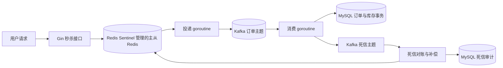

# Go 秒杀第一阶段



## HTTP 接口

两个接口通过 `Authorization` 读取 `login:token:{token}` 中的用户 ID，支持原始 token 或 `Bearer <token>`。正式登录接口将在用户模块实现，本地联调可用带 TTL 的测试会话。

| 方法和路径 | 行为 |
| --- | --- |
| `POST /voucher-order/seckill/{id}` | `id` 是活动 ID。成功返回 `202` 和字符串 `data.orderId`。重复提交返回 `409` 和原订单 ID。活动未初始化返回 `404`，售罄或超出活动时间返回 `409`。 |
| `GET /voucher-order/{orderId}` | 查询自己的订单。`pending` 表示 Redis 已受理，`confirmed` 表示 MySQL 已确认落单，历史数据中的 `review_required` 表示库存差异需要核对。不存在或属于其他用户时返回 `404`。 |

## 支撑抢购的四个步骤

1. **Redis Lua 受理。** Lua 以 Redis 自己的时钟检查活动时间，在同一次执行中扣减可抢库存、记录买家和订单 ID、写入事件及待投递索引。事件保存在 Redis String，待投递索引用有序集合记录下次可领取时间。收到 `202` 后可查询进度。
2. **后台投递。** 投递 goroutine 领取待发送记录后设置 15 秒租约。Kafka 确认后移出待投递索引。投递失败或进程在确认前退出时，其他循环可在租约到期后重新发送，订单 ID 保持一致。
3. **消费落库。** 消费者按顺序处理消息，在 GORM 事务里条件扣库存并插入订单。遇到重复订单时，MySQL 唯一索引让整个事务回滚，消费者核对同一个订单 ID 后提交 offset。消息无效、订单冲突或 MySQL 库存不足时，先写入死信主题，再提交原 offset。MySQL 暂时不可用时保留原消息并退避重试。
4. **死信对账。** 对账 goroutine 按自己的 Kafka 消费组读取死信。它会把每条死信写入 `seckill_dead_letters`，并区分 `compensated`、`already_persisted` 和 `manual_review`。只有 MySQL 已存在其他订单、Redis 仍保存当前事件的买家占用且订单事件仍可定位时，才执行 Lua 原子补偿。补偿会恢复 Redis 库存、删除买家占用、删除事件和待投递索引，并用补偿标记键保证重复消费不会重复加库存。

三类后台循环和 Gin 目前在同一个 Go 进程。Relay 默认运行 4 个 goroutine，订单消费者默认运行 3 个 Kafka Reader，对应订单主题的 3 个分区。多个消费者共享同一个 Kafka 消费组，同一分区仍由一个消费者按顺序处理。HTTP Handler 用请求的 `Context` 限制单次操作时间，后台循环有独立的生命周期。退出时先等待在途 HTTP 请求收尾，再通知后台停止领取和拉取，已开始的操作有独立的截止时间。

当前以 Redis AOF 恢复待投递记录。Compose 使用 `appendfsync always`，主节点要求至少有一个副本在 10 秒内确认复制，三个 Sentinel 以 `hmdp-master` 监控主节点。活动开始后若 Redis 库存记录丢失，初始化命令会拒绝重新发放库存。无效事件、Redis 买家占用与死信不匹配以及 MySQL 库存不一致都会进入人工复核，避免在事实不足时盲目增加库存。

## 本地体验

按 [README](../README.md) 启动依赖，再从仓库根目录准备独立的 Go 数据表和活动。每次新实验选一个新的 `voucher-id`。

```bash
docker compose exec -T mysql sh -c 'MYSQL_PWD="$MYSQL_PASSWORD" mysql -u "$MYSQL_USER" "$MYSQL_DATABASE"' < migrations/001_seckill.sql
docker compose exec -T mysql sh -c 'MYSQL_PWD="$MYSQL_PASSWORD" mysql -u "$MYSQL_USER" "$MYSQL_DATABASE"' < migrations/002_seckill_dead_letters.sql

go run ./cmd/api prepare-seckill -voucher-id 42 -stock 10 \
  -starts-at "$(date -u -d '+30 seconds' +%FT%TZ)" \
  -ends-at "$(date -u -d '+20 minutes' +%FT%TZ)"

docker compose exec -T redis redis-cli HSET login:token:demo-7 id 7
docker compose exec -T redis redis-cli EXPIRE login:token:demo-7 600
```

启动 `go run ./cmd/api` 后，等活动开始再发请求。将返回的 `data.orderId` 用在第二个请求中。

```bash
curl -i -X POST -H 'Authorization: Bearer demo-7' http://127.0.0.1:8080/voucher-order/seckill/42
curl -i -H 'Authorization: Bearer demo-7' http://127.0.0.1:8080/voucher-order/ORDER_ID
```

## 本地联调记录

使用独立运行的 MySQL 8.0.33、Redis 7.2.11 和 Kafka 4.1.2。停止 Kafka 后，以最多 100 个并发客户端提交 1000 个不同用户请求，库存为 100。收到 100 个 `202` 和 900 个售罄响应，已受理订单可查到 `pending`。重启 Kafka 后，100 笔订单全部转为 `confirmed`，两个库存计数均为 0。额外重放一笔已落库订单并发送一条非法消息，最终订单仍为 100 笔，消费者积压归零，非法消息出现在死信主题。进程级故障演练还验证了 Redis Sentinel 从 `127.0.0.1:29933` 切换到 `127.0.0.1:29936`、10,000 条 Kafka 积压在 40 秒内归零以及自动补偿审计结果为 `compensated`。Redis Sentinel、Kafka 长积压和自动补偿场景分别由仓库 `scripts/` 下的三个脚本复现。
