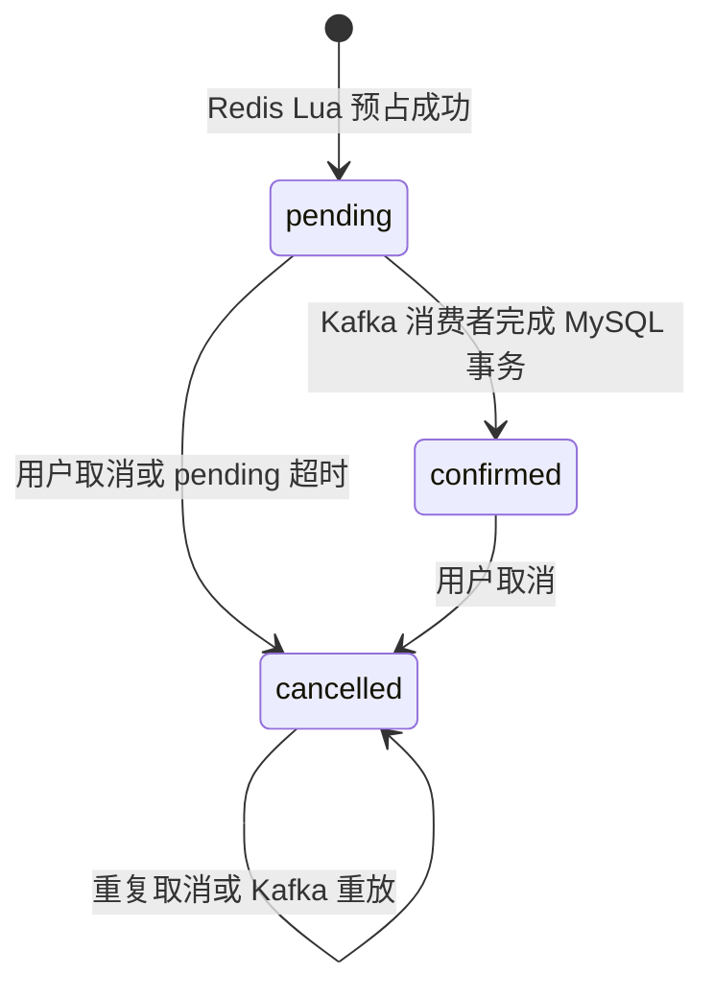

# 阶段 4 秒杀订单生命周期

阶段 4 把秒杀链路从“Redis 受理后异步落单”的样例补成了可取消、可超时、可恢复、可审计的订单状态机。

## HTTP 接口

| 方法和路径 | 成功响应 | 行为 |
| --- | --- | --- |
| `POST /voucher-order/seckill/:id` | `202` | Redis 原子预占库存并创建 pending 订单事件 |
| `GET /voucher-order/:id` | `200` | 查询自己的 pending、confirmed 或 cancelled 订单 |
| `GET /voucher-order?current=1` | `200` | 分页查询 MySQL 订单历史 |
| `POST /voucher-order/:id/cancel` | `200` 或 `202` | 取消订单并释放占用。`202` 表示 MySQL 已取消，Redis 补偿正在后台重试 |

取消接口的响应数据包含订单和 `compensationPending`。订单不存在或属于其他用户时返回 `404`。无法取消的历史状态返回 `409`。

## 状态机



`pending` 只存在于 Redis。`confirmed` 和 `cancelled` 是 MySQL 中的最终事实。消费者确认订单后清理 Redis 事件和超时索引，同时保留买家占用。取消完成后删除买家占用，用户可以再次参与同一活动。

## 完整调用链

### 提交秒杀

1. [`submit`](../internal/seckill/http.go) 从鉴权 `Context` 取得用户 ID，并生成 26 位随机订单 ID。
2. [`reserveStock`](../internal/seckill/redis.go) 在一段 Lua 中检查活动时间、库存和重复购买，随后扣减 Redis 库存，记录买家、订单事件、outbox 和超时时间。
3. HTTP 返回 `202`。此时订单状态是 pending，请求线程不等待 Kafka 和 MySQL。

### Kafka 确认订单

1. [`relay`](../internal/seckill/worker.go) 从 Redis outbox 领取事件并发送到 Kafka。领取使用 15 秒租约，发送中断后可以重新领取。
2. [`consume`](../internal/seckill/worker.go) 顺序读取分区消息。[`persistOrder`](../internal/seckill/store.go) 在一个 MySQL 事务中条件扣减库存、插入订单并创建活动买家占用。
3. 事务成功后，消费者调用 `finalize` 清理 Redis 订单事件、outbox 和超时索引，然后提交 Kafka offset。
4. 重复消息会读取相同订单。已经 confirmed 或 cancelled 的同一事件直接视为成功，因此不会重复扣减 MySQL 库存。

### 用户取消

1. [`cancel`](../internal/seckill/http.go) 先从 MySQL 查订单。订单尚未落库时再从 Redis 读取 pending 事件。
2. [`cancelOrder`](../internal/seckill/lifecycle.go) 使用带行锁的 GORM 事务写入 cancelled 状态。confirmed 订单会恢复 MySQL 库存并删除活动买家占用。pending 订单不会修改 MySQL 库存，因为消费者还没有执行扣减。
3. 同一事务写入 `seckill_order_resolutions`。这条记录表示 Redis 补偿必须完成。
4. 请求线程尝试执行 Redis Lua 补偿。成功返回 `200`。Redis 暂时失败时返回 `202`，后台任务继续扫描未完成记录。

### pending 超时

每次 Redis 预占都会写入 `seckill:{orders}:timeouts`。[`expireReservations`](../internal/seckill/worker.go) 领取到期订单，创建 cancelled 订单并执行同一套补偿流程。默认超时为 15 分钟，可通过 `SECKILL_PENDING_TIMEOUT` 调整。

Kafka 短暂中断时，outbox 会保留事件并继续重试。中断超过 pending 超时时间后，订单会取消并释放库存。Kafka 随后收到旧事件时会识别 MySQL 中的 cancelled 订单，不再扣减库存。

## 一人一单与取消后重购

旧实现直接在 `seckill_orders(voucher_id, user_id)` 上放唯一索引。这样可以阻止重复订单，也会永久阻止取消后的重购。

迁移 [`006_order_lifecycle.sql`](../migrations/006_order_lifecycle.sql) 增加 `seckill_order_claims`。这张表只保存当前有效占用，主键仍是 `(voucher_id, user_id)`。订单历史可以保留多条 cancelled 记录，当前活动仍只有一条有效订单。取消时删除 claim，下一次购买可以创建新的 claim。

## 异常订单与补偿

Kafka 消费失败分成三类处理。

| 原因 | 处理结果 |
| --- | --- |
| 非法事件 | 写入 `seckill_dead_letters`，结果为 `manual_review` |
| 活动买家冲突 | 创建 cancelled 订单，原子恢复 Redis 预占，审计结果为 `compensated` |
| MySQL 库存不足 | 创建 cancelled 订单，以 MySQL 剩余库存修正 Redis，并记录 `inventory_reconciled` |

Redis 补偿使用每个订单独立的 resolution key。重复执行 Lua 时不会再次增加库存。MySQL 的 resolution 表记录重试次数和最后一次错误，进程重启后仍可继续补偿。

## Go 学习点

- `Service` 的方法接收者把数据库、Redis、日志和超时配置组合在一个模块内。
- `context.WithTimeout` 限制单次 HTTP、数据库和中间件操作。`context.WithoutCancel` 让后台收尾拥有独立的短截止时间。
- `sync.WaitGroup.Go` 管理 Relay、Consumer、DLQ、超时扫描和补偿扫描 goroutine。应用关闭时统一等待它们退出。
- `errors.Is` 区分订单不存在、状态冲突、Redis 空值和 GORM 未找到记录。
- GORM `Transaction` 与 `clause.Locking{Strength: "UPDATE"}` 让并发取消、Kafka 落单和重复请求在数据库中串行决定最终状态。
- Redis Lua 把多个 key 的检查和修改放进一次原子执行，Go 只处理脚本返回的业务结果。
- Kafka 使用至少一次投递。业务幂等由订单 ID、活动 claim、事务和 Redis resolution 标记共同保证。

## 验证

基础检查命令如下。

```bash
go test ./...
go vet ./...
go test -race ./...
bash -n scripts/order-lifecycle-smoke.sh
```

端到端脚本会启动隔离依赖并验证取消后重购、Kafka 暂停后恢复、pending 超时、补偿失败后自动重试，以及 MySQL 和 Redis 最终库存一致。

```bash
scripts/order-lifecycle-smoke.sh
```

当前代码已通过 Go 单元测试、静态检查、竞态检测和脚本语法检查。当前执行环境无法访问 Docker socket，因此本轮没有实际启动 Compose 故障脚本。
