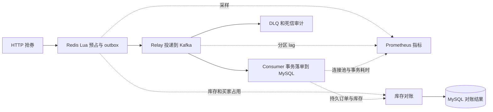

# 阶段 6 · 秒杀监控、对账和高可用演练

秒杀仍在模块化单体内运行。HTTP 请求通过 Redis Lua 预占，Relay 把 Redis outbox 的事件发给 Kafka，Consumer 完成 MySQL 事务后提交消费位置。监控贯穿这些步骤，库存审计和订单补偿各自运行。



已有阶段 5 数据库先应用 `migrations/009_inventory_audits.sql`。新库按 `001` 到 `009` 执行迁移。迁移新增 `seckill_inventory_audits` 表。

## 监控与 Go 源码

```bash
OBSERVABILITY_ADDR=127.0.0.1:9091 PPROF_ENABLED=true go run ./cmd/api
curl -fsS http://127.0.0.1:9091/metrics
curl -fsS http://127.0.0.1:9091/debug/pprof/goroutine?debug=1
curl -fsS 'http://127.0.0.1:9091/debug/pprof/profile?seconds=20' -o /tmp/hmdp-cpu.pprof
go tool pprof -top /tmp/hmdp-cpu.pprof
promtool check config deploy/prometheus/prometheus.yml
prometheus --config.file=deploy/prometheus/prometheus.yml --web.listen-address=127.0.0.1:9090
```

`OBSERVABILITY_ADDR` 默认留空。填写后，诊断监听器只接受 loopback IP。`PPROF_ENABLED` 独立控制性能剖析入口。

| 想知道什么 | 指标与读法 |
| --- | --- |
| 抢券 HTTP 延迟有多高 | `hmdp_http_request_duration_seconds` 按 Gin 路由模板和状态码统计。用 `_count` 看请求量和错误率，用 `_bucket` 计算百分位 |
| 请求卡在 Redis、Kafka 还是 MySQL | `hmdp_seckill_operation_duration_seconds` 分别记录 `redis_reserve`、`kafka_publish`、`mysql_persist`、死信和补偿的耗时与结果 |
| 哪个分区堆积 | `hmdp_seckill_kafka_lag` 用分区末尾位置减去消费组下一条位置。首次消费和历史消息到期时采用分区最早可读位置作为下限 |
| Redis 还有多少待处理 | `hmdp_seckill_queue_size` 分别显示 outbox 和超时索引。`hmdp_seckill_outbox_due_delay_seconds` 显示最早当前调度时间已经逾期多久，重试租约会刷新该时间 |
| 采样是否仍在更新 | `hmdp_seckill_monitor_last_success_timestamp_seconds`。采样失败会保留上次的 lag 和队列值，并停止刷新该数据源的时间戳 |
| Worker 和连接池表现怎样 | `hmdp_seckill_workers`、`go_goroutines`、`go_sql_in_use_connections`、`go_sql_wait_count_total`、`hmdp_redis_pool_timeouts_total` |
| 有多少重试、死信或库存差异 | `hmdp_seckill_retries_total`、`hmdp_seckill_operation_duration_seconds_count` 中的死信结果、`hmdp_seckill_inventory_checks_total` |

HTTP P99 示例，可以把 `0.99` 换成 `0.999` 查看 P99.9。百分位精度受直方图区间影响。

```promql
histogram_quantile(0.99, sum by (le) (
  rate(hmdp_http_request_duration_seconds_bucket{route="/voucher-order/seckill/:id"}[5m])
))
```

从 [`app.Run`](../internal/app/app.go) 读起。它创建独立的 Prometheus `Registry` 并把指标中间件注册到 Gin。中间件调用 `c.Next()` 让鉴权与业务处理继续执行，随后记录完整请求的状态和耗时。HTTP 标签使用 `/voucher-order/seckill/:id` 这样的模板，所以不同券 ID 共用指标。

再读 [`RunMonitoring`](../internal/seckill/metrics.go)。它使用 `time.NewTicker` 定时发送采样信号，`select` 同时等待信号或退出通知，每轮通过 `context.WithTimeout` 限定访问中间件的时间。Prometheus 访问 `/metrics` 时读取已采好的数据。告警文件涵盖诊断端口掉线、指标陈旧、队列积压及人工复核。

`SECKILL_OUTBOX_LIMIT` 可以按共享 outbox 的条数启用背压，默认 `0` 表示关闭。达到门槛时，预占 Lua 返回过载，HTTP 回 `503` 和 `Retry-After: 1`，库存和买家占用保持原值。`ZCARD` 检查和预占处于同一 Lua 执行里，多个 API 实例共用该门槛。Kafka 已积压条数由分区 lag 指标单独衡量。

## 库存对账

```bash
go run ./cmd/api audit-seckill -voucher-id 9610
```

命令会输出 JSON 并保存该活动的最新对账结果。后台每分钟按活动 ID 排序分批检查，每批最多 20 个活动，`SECKILL_AUDIT_INTERVAL` 可以调整间隔。对账读两次 Redis，把中间那次 MySQL 查询放在同一个 SQL 语句中。两次 Redis 读数不同就记录 `blocked`，等待后续采样。

| 状态 | 当前处理 |
| --- | --- |
| `consistent` | MySQL 剩余库存加确认订单数等于总库存，Redis 剩余库存加买家占用数也等于总库存。Redis 买家包含已确认订单以及仍有占用的预占 |
| `repairable` | 计数通过检查，MySQL 有待同步的取消记录。已有补偿 Worker 按订单重试 Redis，成功后标记 `redis_synced` |
| `manual_review` | 库存、买家占用、购买资格或活动时间有差异，保留读数供定位 |
| `blocked` | Redis 暂不可用，或采样期间 Redis 读数变化。MySQL 不可用时通过日志和采样时间戳定位 |

计数对账是跨存储抽样，逐笔核对仍需要订单和 Redis 记录。它不能靠数量确认某个买家的身份，也无法重建已经丢失的预占。人工复核可按日志中的 `voucher_id` 查最新记录，再查看 `seckill_order_resolutions`、`seckill_dead_letters` 和 `seckill_reservation_anomalies`。历史差异可从日志追查，`seckill_inventory_audits` 每券保留一条最新结果。

```sql
SELECT voucher_id, status, detail, checked_at, mysql_remaining, redis_remaining, redis_buyers
FROM seckill_inventory_audits
WHERE status IN ('manual_review', 'repairable', 'blocked')
ORDER BY checked_at DESC;
```

## 三节点 Kafka 配置

独立 Compose 项目用新的数据卷创建 KRaft 集群。运行前确保示例端口可用，可在 `.env` 中为该项目设置独立端口。

```bash
docker compose -p hmdp-go-ha -f compose.yaml -f compose.kafka-ha.yaml up -d --wait
export KAFKA_BROKERS=127.0.0.1:29092,127.0.0.1:29093,127.0.0.1:29094
```

在该项目的 MySQL 应用迁移后启动 API。Kafka 订单和死信主题在新集群按 Broker 默认值创建为 3 副本，`min.insync.replicas=2`。应用 Producer 使用 `acks=all`。已有主题的副本布局需要另行迁移。三个本机 Broker 可以演练进程故障，机器级容灾需要让副本跨主机部署。

```bash
ha=(docker compose -p hmdp-go-ha -f compose.yaml -f compose.kafka-ha.yaml)
"${ha[@]}" exec -T kafka-2 /opt/kafka/bin/kafka-topics.sh \
  --bootstrap-server kafka-2:9092 --describe --topic hmdp.seckill.order.v1
"${ha[@]}" kill -s SIGKILL kafka
# 使用测试活动提交订单，检查最终订单、库存和分区 lag。
"${ha[@]}" start kafka
```

## 本地验收

| 演练 | 实测结果 |
| --- | --- |
| 三节点 Kafka 关闭一个 Broker | 订单主题三个分区均从存活 Broker 提供服务。故障前 1 笔、故障后 999 笔抢券全部确认，Broker 回来后三个分区恢复为 3 个同步副本 |
| 阻塞 MySQL 活动库存行 | 累积 500 条 Kafka lag。释放锁后，三个分区 lag 清零，累计 1,500 笔确认订单，MySQL 与 Redis 剩余库存均为 0 |
| 库存差异 | 测试环境将 Redis 库存从 0 人为改为 1，审计记录 `manual_review`，库存保持为 1。恢复后对账记录回到 `consistent` |
| Redis Sentinel | 旧主停止后副本晋升，两笔订单均确认，新主库存为 0 |
| outbox 背压 | 达到门槛时返回 `503` 和 `Retry-After`，库存未扣。清空后重试并确认订单 |
| 3,000,000 次 HTTP 重复抢券 | 96 个客户端并发，约 140 秒，约 21,412 请求/秒，错误为 0，P99 为 9ms。结束后两个 Redis 队列和 MySQL 使用中的连接数均为 0，Go goroutine 两次读数为 62 和 66 |

HTTP 吞吐测的是重复抢券路径。实际落单、库存核对和 Kafka 积压对应上表里的独立演练。

演练使用独立的本机 MySQL、Redis 和 Kafka 进程。当前环境缺少 Docker socket 权限，Compose 叠加配置通过 `docker compose config -q`。一小时以上持续压测、百万级 Kafka backlog、跨主机故障、Redis Cluster 分片、完整备份恢复和死信重放工具仍待验证或实施。Redis Sentinel 切主由异步复制支撑，演练结果只覆盖本次故障窗口。
