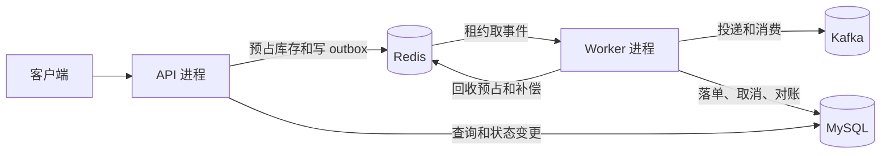

# 阶段 7 · API、Worker 和恢复演练



两种进程使用同一份业务代码。`cmd/api` 注册登录、商户、优惠券、订单和社交 HTTP 路由，`cmd/worker` 运行秒杀和社交后台任务。Worker 停机时，API 可以继续预占并把事件留在 Redis outbox。Worker 恢复后，它处理 outbox 并从 Kafka 已提交位置继续消费。秒杀订单的 MySQL 事务和一人一单约束应对重复投递。

## 启动与升级

先启动中间件并应用 `001` 到 `010`，再在两个终端用同一套中间件配置启动。阶段 7 的历史演练使用 `009` 后的表结构。

```bash
# Terminal 1
OBSERVABILITY_ADDR=127.0.0.1:9091 go run ./cmd/api

# Terminal 2
OBSERVABILITY_ADDR=127.0.0.1:9092 go run ./cmd/worker
```

API 默认监听 `127.0.0.1:8080`，Worker 的健康端口是 `127.0.0.1:8081`，可用 `HTTP_ADDR` 和 `WORKER_HEALTH_ADDR` 分开调整。两个入口都提供 `/health/live` 和 `/health/ready`。API 就绪检查 MySQL 和 Redis。Worker 再检查 Kafka 和后台循环的启动状态。想确认事件是否持续推进，访问 Worker 侧指标观察 Kafka lag、Redis outbox 和采样时间戳。两个监控地址可用 [Prometheus 拆分配置](../deploy/prometheus/prometheus.split.yml) 同时采集。

Linux 本机可用 [Compose 应用配置](../compose.apps.yaml) 启动两个镜像。它通过 host 网络访问原有本机中间件端口。按 README 准备 `.env` 和迁移后执行以下命令。

```bash
docker compose -f compose.yaml -f compose.apps.yaml up -d --build api worker
docker compose -f compose.yaml -f compose.apps.yaml up -d --build --no-deps worker
```

升级时先部署两个入口并检查健康，再停旧进程。新旧 Worker 在同一个 Kafka 消费组内重叠运行时，分区会重新分配。回滚时停止两个新进程，用 `go run ./cmd/all` 恢复原先的单进程模式，共用原有数据库、库存和消费组。多个副本部署在同一机器时，各自要使用独立的 HTTP、Worker 健康和诊断端口。

## 从哪里读 Go 源码

1. [`cmd/api/main.go`](../cmd/api/main.go) 把 `SIGTERM` 变成 `Context` 取消通知。`RunAPI` 收到通知后先停止接收连接，再给正在处理的请求留出时间。
2. [`RunWorker`](../internal/app/worker.go) 启动健康服务和三个后台任务。两个业务循环启动后向同一个原子计数器报告，`/health/ready` 从其他 goroutine 并发读取计数。停机时先把 Worker 标为不可用，再取消工作上下文。
3. [`startBackground`](../internal/app/worker.go) 启动三个 goroutine。每个任务结束后把结果放进有缓冲的 channel。控制函数收齐后关闭 Kafka、Redis 和 MySQL 客户端。这一顺序让处理中订单完成或保留在可重试位置。
4. [`RunWorkers`](../internal/seckill/worker.go) 从 Redis 领取带租约的记录，Kafka 确认投递后移除 outbox 记录。Consumer 在 MySQL 成功后提交 Kafka offset。实例故障时，另一实例可以接手租约到期记录和未提交的 Kafka 消息。

扩容时 `KAFKA_CONSUMER_WORKERS` 是单个 Worker 进程的消费者数，当前订单主题有 3 个分区。多个进程以消费者总数衡量并行度。`MYSQL_MAX_OPEN_CONNS` 是单进程连接池上限，默认 20。各进程的上限加起来要落在 MySQL 可用连接数内，结合 `go_sql_wait_count_total` 和 `go_sql_wait_duration_seconds_total` 看是否出现排队。预期的 GORM 查空跳过错误日志，慢查询和实际 SQL 错误继续记录。落单和超时取消并行时，两个事务统一先锁 `seckill_activities` 活动行，再写订单，避免 InnoDB 外键检查时出现环形等待。

`SECKILL_PENDING_LIMIT` 可选限制整个秒杀模块的待处理预占数，默认 `0` 关闭。Redis Lua 用超时索引计数，所以事件发进 Kafka 后也会继续占用名额。达到门槛的正常新请求返回 `503` 和 `Retry-After: 1`，预占只在有余量时执行。它与 `SECKILL_OUTBOX_LIMIT` 可以同时使用。

## 本机备份恢复与持续压测

[演练脚本](../scripts/stage7-local.sh) 启动独立的 MySQL、Redis 和 Kafka，把数据和日志放在 `runtime/stage7-*`。退出时回收测试进程及运行中的数据目录，保留日志、报告和 `restore` 模式生成的备份。设置 `MYSQL_BIN_DIR`、`REDIS_BIN_DIR` 和 `KAFKA_BIN_DIR` 后执行以下命令。并行运行时各用一个 `STAGE7_BASE_PORT`。

```bash
scripts/stage7-local.sh restore
STAGE7_BASE_PORT=29860 SOAK_SECONDS=3660 SOAK_RATE=10 scripts/stage7-local.sh soak
```

恢复测试先确认一笔订单，再在 Worker 停止期间制造两笔 pending 订单，一笔留在 Redis outbox，一笔已投递到 Kafka。停写后导出 MySQL，正常关闭 Redis 和 Kafka，再拷贝 Redis 的整个 AOF 目录以及 Kafka 日志目录。用新目录启动三种存储，检查 MySQL 的确认订单、Redis 的预占和 outbox、Kafka 的消息与已提交 offset。最后启动 Worker 排空积压并做库存对账。脚本验证的是隔离环境的冷备份恢复，停写窗口和三节点备份拓扑需在实际部署中另测。

持续压测按秒提交独立用户，验收记录包含 HTTP 接收数与 P99、MySQL 最终确认数、库存对账、Redis 队列和各分区 lag。API 的 `202` 只代表预占成功，最终落单以确认订单和库存为准。将 `SOAK_RATE` 调高前留意 MySQL 热点行锁和 Kafka 积压。

## 已完成的本机演练

| 演练 | 结果 |
| --- | --- |
| 停 Worker、重启 API | 第二个 API 仍可预占。第一个 API 重启后查到同一笔 pending 订单 |
| MySQL、Redis、Kafka 冷备份恢复 | MySQL 原有一笔确认订单，Redis outbox 一笔待投递订单，Kafka 一笔待消费订单，以及消费组已提交位置均恢复。Worker 启动后恢复两笔 pending，Kafka lag 清零 |
| 待处理上限 | Redis outbox 只有一笔，另有一笔已进入 Kafka。达到总上限时新请求返回 `503`，库存维持原值。恢复后重试成功，累计确认四笔，剩余库存为 0 |
| 三 Broker 本机故障 | 停掉一个进程时 API 仍就绪。Broker 回归后订单主题三个分区的 ISR 均恢复到 3 |
| Redis Sentinel 本机切主 | 独立 API 和 Worker 都重新连接到新主，切换前后两笔订单均确认，新主库存为 0 |
| Worker 扩缩容 | 两个 Worker 分别获得订单分区。退出其中一个后，剩余 Worker 接管全部三个分区 |
| 60 秒真实落单 | 3 个 Consumer，每秒 10 笔，600 笔获接收并最终确认，队列和 lag 清零，库存对账一致 |
| 确认与超时并发回归 | 在真实 MySQL 上重复运行三轮。每轮对同一活动并行提交 24 对确认和取消，订单数、领取资格和剩余库存均通过核对 |

### 61 分钟持续真实下单

在同一台机器上运行 API、Worker、MySQL、Redis 和三个 Kafka Broker，使用 36,600 个不同的抢券会话，每秒提交 10 笔，测试预占超时设为 120 秒。请求持续 3,660.01 秒，全部返回 `202`，HTTP P99 为 469.84 ms。最终有 34,260 笔确认、2,340 笔超时取消。Redis 与 MySQL 的剩余库存均为 2,340，库存对账为 `consistent`。Kafka 三个订单分区的 lag、Redis outbox、预占超时索引和未同步补偿数均为 0。

前段用 1 个 Consumer，Kafka lag 增至约 2,000 条，预占开始超时。扩到 3 个 Consumer 时，InnoDB 报告了确认和超时取消事务的锁循环。不中断 HTTP 流量，换上统一加锁顺序的 Worker 后，修复版本日志中未再出现 `Error 1213`，积压随后排空。修复版本 Worker 约 40 分钟采样的 goroutine 数在 75 至 81 之间，结束时 API 和 Worker 的 MySQL 使用中连接和连接池等待次数均为 0。

这次长测包含 Kafka Broker 崩溃、Worker 扩缩容和运行中换版。全程以修复版本承载的单独短测确认了 600 笔。更高的持续落单速率、MySQL 活动行热点、Kafka 批量提交与 Redis Cluster 分片仍可继续测量。

Docker Compose 配置通过校验。当前用户无权连接 Docker daemon，演练使用本机进程。

## 跨主机验收

准备三个独立测试主机，每台各有一个 Kafka Broker 和 KRaft Controller。配置可跨主机访问的 `advertised.listeners` 和 `controller.quorum.voters`。Redis 主从分布在不同主机，三个 Sentinel 分布在三个主机。压测端和 API 分开部署，并让至少两个 API 和两个 Worker 连接同一套中间件。

1. 记录故障前的确认数、队列和 ISR。持续发送新用户抢券，保留返回的订单 ID。
2. 停止运行 Kafka leader 的测试主机。在另两台上查看 ISR、发生切换后的请求和订单状态，恢复该主机并确认 ISR 回到 3。
3. 单独停止 Redis 主节点所在的测试主机，记录切换耗时、`503` 数、恢复后库存差异和无法找回的预占。MySQL 单实例部署要单独统计不可用窗口。
4. 停止一个 API 或 Worker，观察健康路由与 Kafka 重新分配。请求结束后按订单 ID 核对确认、取消或人工复核状态，确认库存无超卖及最终 lag 清零。

本机三 Broker 测试可以覆盖进程故障和重新选主。跨主机验收需要拥有对应的测试主机和故障操作窗口。
