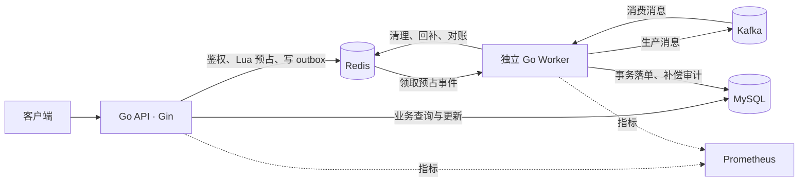

# 本地生活平台 Go 版项目总览

本项目以 Java 版业务为参考，使用 Go 实现本地生活服务后端。五个业务模块在同一仓库内共享配置、连接和日志。对外提供一个 HTTP API，异步任务可独立部署为 Worker。单进程入口 `cmd/all` 用于本地联调。

| 模块 | 已实现的业务 |
| --- | --- |
| 用户 | 验证码登录、Redis Token、鉴权与续期、资料查询、退出、Bitmap 签到 |
| 店铺 | 分类、列表、名称与详情查询、详情缓存、维护、按距离查询附近店铺 |
| 优惠券 | 普通券和秒杀券的创建与查询、活动时间窗、库存预热 |
| 秒杀订单 | 抢券、一人一单、异步落单、状态与历史查询、取消、超时回补、死信与库存对账 |
| 社交 | 发布探店博客、热门与明细、点赞、关注、共同关注、关注动态、异步发帖通知 |

这一版完成上述后端范围。支付、评论与文件上传，前端改造和生产接入仍在后续范围。

## 架构与秒杀链路

抢券入口 `POST /voucher-order/seckill/:id` 从 Redis 取登录态，Lua 在一次执行中核对时间、库存和买家占用，写入预占与 outbox。API 返回 `202` 和订单 ID。Relay 领取 Redis 记录，Kafka 确认后清理待投递项。Consumer 按订单 ID 幂等处理，通过 MySQL 事务更新库存与订单，完成后提交 offset。若遇到取消、超时或无法处理的事件，补偿和死信审计保留处理结果。用户可用 `GET /voucher-order/:id` 查询最终状态。

- **Redis** 用于登录态、热点缓存、签到、GEO、库存预占、待投递队列与超时索引。
- **MySQL** 记录业务数据和最终订单事实，通过事务和领取资格唯一键约束库存与重复下单。
- **Kafka** 承载秒杀订单与发帖通知的异步投递，消费组记录进度，死信进入审计流程。
- **Gin、GORM、go-redis、kafka-go、Prometheus** 分别覆盖路由、数据库、Redis、消息和指标。`pprof` 用于采集 Go 运行数据。

## Go 阅读路线

1. 从 `cmd/api/main.go` 看入口怎样读取配置、处理信号并启动 API，再到 `internal/app` 看依赖如何组装、健康检查怎样运行。 [程序入口](../cmd/api/main.go)
2. 从登录 Handler 跟到 Token 中间件，理解如何用 `Context` 传递登录用户，如何通过超时与取消约束 Redis 或 MySQL 请求。 [用户模块](07-user-authentication.md)
3. 从秒杀 `submit` 读到 Lua，继续跟 `RunWorkers` 的 Relay、Consumer 和库存回补。重点看 goroutine 的职责、`WaitGroup` 如何等待退出，以及 Kafka offset 的提交顺序。 [秒杀设计](03-seckill-design.md) [进程拆分](13-split-api-worker.md)
4. 顺着 Prometheus 的 HTTP 延迟、Kafka lag、MySQL 事务耗时与 Redis 对账看一次演练，最后读 `pprof`。 [监控与对账](12-seckill-operations.md) [容量与发布](14-capacity-and-release.md)

## 初步收尾标准

- 本地能按 README 建库、启动 API 与 Worker、完成主要业务演示和真实下单。
- 支持查看库存、积压、死信与补偿状态。备份恢复能在隔离环境复现。
- 已记录千万级 HTTP 场景、长时间真实下单、多个本机进程的容量演练，以及 Redis、Kafka 和 MySQL 故障结果。
- 生产验收还需落实跨主机故障、百万常驻连接、多 Broker 整套备份恢复和生产容量基线。阶段 8 文档提供对应的指标与验收步骤。

## 从一次请求看到各层的职责

| 用例 | 接口 | 源码里发生的事 |
| --- | --- | --- |
| 登录并访问个人资料 | `POST /user/code`、`POST /user/login`、`GET /user/me` | 验证码用 Redis Lua 一次性核销。登录后 Redis Hash 保存用户和会话有效期。鉴权中间件读取 `Authorization: Bearer <token>`，把身份放入请求的 Go `Context`，且接近过期时才续期。`/user/me` 直接读出已验证身份。 |
| 看店铺详情 | `GET /shop/:id` | 先读 Redis，未命中时查 MySQL 并回填。每个 API 进程有 64 个带缓冲通道，通过店铺 ID 取模来限制同一组缓存回填。不同进程共享 Redis，分别管理自己的通道。 |
| 查附近店铺 | `GET /shop/of/type?typeId=1&x=113.32&y=23.13` | Java 版常用参数仍可用。Go 版先查 MySQL 分类版本，再用 Redis `GEOSEARCH` 找 5 公里内的 ID 和距离，最后用 MySQL 查详情，在 Go 中还原距离顺序。 |
| 发帖和关注动态 | `POST /blog`、`GET /blog/of/follow`、`GET /blog/notifications` | 发帖事务同时写博客和通知的 outbox。Worker 投递 Kafka 并消费，分批把通知写入关注者的 Redis Sorted Set。关注动态走 MySQL 并按博客 ID 使用游标翻页。 |
| 抢券和确认订单 | `POST /voucher-order/seckill/:id`、`GET /voucher-order/:id` | HTTP Handler 从 `Context` 读用户 ID。Lua 先预占库存并写 outbox，Worker 经 Kafka 异步落库。HTTP `202` 表示已受理，查到 `confirmed` 才表示订单已在 MySQL 确认。 |

目录结构和进程生命周期可以一起读。`internal/app` 在入口创建连接并用构造函数传给各模块。Gin Handler 基于请求创建带超时的 `Context`，把它传给 GORM 和 go-redis。`cmd/worker` 通过 `signal.NotifyContext` 接收退出信号，并将取消传播到后台循环。循环中的 goroutine 用 `sync.WaitGroup` 汇合，Worker 等后台任务退场，再释放连接。

源码入口见 [API 和 Worker 组装](../internal/app)、[身份中间件](../internal/user/http.go)、[店铺详情缓存](../internal/shop/service.go)、[GEO 查询](../internal/shop/geo.go)、[社交通知](../internal/social/notifications.go)和[秒杀 Worker](../internal/seckill/worker.go)。

在用户、店铺和博客达到更大数据量时，可用[目录与社交容量基线](16-catalog-capacity.md)复现查询压测，查看优先优化项。
